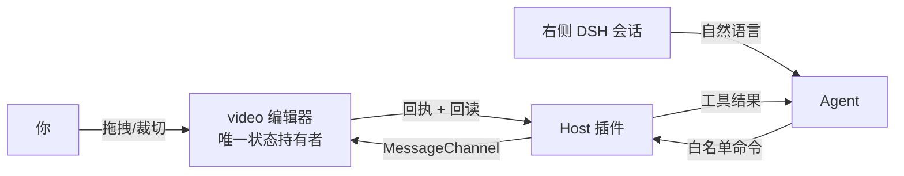

# DSH 视频编辑器 · 人机协作

[](./plugin/dsh-media-video/package.json)
[](./video)
[](https://nodejs.org)
[](https://github.com/deepseek-ai/deepseek-harness)
[](#导出)
[](#状态)

**在 DSH 里，人和 Agent 剪辑同一条时间线。** 左侧是原生 video/Canvas 编辑器，右侧是真正的 DSH 会话。
你说一句「把开头那三秒裁掉，加一行标题」，Agent 通过受控命令改你正在编辑的工程——改动立刻可见，也能撤销。

剪辑软件不该被切成「人做一个版本、AI 做另一个版本」。这里只有一份工程状态，人机共用同一条命令通道。

**当前版本 `0.1.0`**：版本号的唯一来源是 [`plugin/dsh-media-video/package.json`](./plugin/dsh-media-video/package.json)；编辑器顶栏徽标与 `/media-video/boot` 的 `editorVersion` 都由服务端注入，页面里不写第二份。

## 能力

| 能力 | 状态 |
| --- | --- |
| 单轨剪辑（trim，支持单边省略边界） | 已实现 |
| 文字 / 图片叠加（整数微秒时间轴） | 已实测：写入 → 回读 → 人工撤销 |
| 撤销 / 重做（含定向撤销） | 已实现，冲突返回 `HISTORY_CONFLICT` |
| 音画合成导出（源画面 + 叠加 + 音轨） | 已实现；抽帧与音轨已验证，成片叠加烧录待复验 |
| 无音轨素材 | 需提示「素材无音轨」并照常导出，待复验 |
| 工程重开媒体重连 | 已实现，待复验 |

## 三条硬约束

- **时间参数一律整数微秒**（1 秒 = 1,000,000）。工具说明直接写清，避免模型猜 `startTime / duration` 被拒。
- **写命令幂等**：`commandId` + `expectedRevision`，写入后立即回读；结果未知记 `unknown`，绝不重放。
- **撤销可信**：成对 `targetCommandId + afterDigest`，与后续修改冲突即拒绝；`redo` 只接受 `{}`。

## 架构



宿主页走 `/media/boot` + `/media/video-relay`，iframe 加载后**自动连接**，不需要手动点「连接」。
诊断信息保留在 DOM 但不显示，不占画布。

## 导出

导出为 **WebM**：合成源画面、有效时间段内的叠加与源音轨。

注意一个坑：MediaRecorder 产出的容器头**没有 duration 字段**，有效性按解码时长判断——播放器显示时长为空不等于导出失败。导入这类素材时同样按解码时长处理。

## 插件包

`plugin/dsh-media-video/` 是可独立安装的 DSH 插件包，只注册视频这一次工具集：

| 工具 | 作用 |
| --- | --- |
| `media_video_read_state` | 读工程状态；首次带 `bind:true` 触发原生审批绑定 |
| `media_video_apply_command` | 提交 `media.video.*` 命令，时间参数为整数微秒 |
| `media_video_get_command_result` | 结果未知时回查，避免盲目重放 |
| `media_video_export_start` / `media_video_export_status` | WebM 导出与状态 |

路由前缀 `/media-video`，与图片插件包（`/media-image`）互不依赖、可同时安装。
## 下载安装

预打包插件（可直接装进 DSH profile）：[v0.0.1 · dsh-media-video-0.0.1.tgz](https://github.com/Brian-dai694/dsh-video-studio/releases/download/v0.0.1/dsh-media-video-0.0.1.tgz)

```powershell
dsh plugin --profile <你的profile> add <下载路径>\dsh-media-video-0.0.1.tgz
```
## 快速开始

```bash
cd video && node --test tests/*.test.mjs
```

## 目录

| 路径 | 内容 |
| --- | --- |
| `video/` | 编辑器源码与测试：`video.js`、`video-state.mjs`、`video-bridge.mjs`、`video-export.mjs`、`video-capabilities.mjs` |
| `plugin/dsh-media-video/` | 独立插件包：Host 工具、命令门控、relay 与视频页产物 |
| `host/` | 视频宿主页、共享 iframe transport |
| `contracts/` | 命令/状态契约、DSH 会话接口核查记录 |

## 状态

原型阶段，隔离环境验证中，**未上生产**。未列出即未验证，不把源码测试当浏览器通过。

图片侧见 [dsh-image-studio](https://github.com/Brian-dai694/dsh-image-studio)。

[](https://github.com/deepseek-ai/deepseek-harness)


